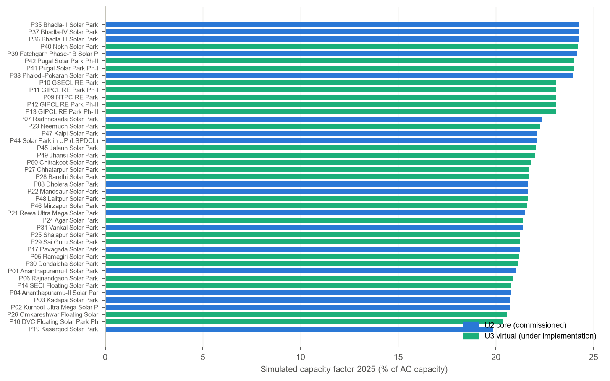
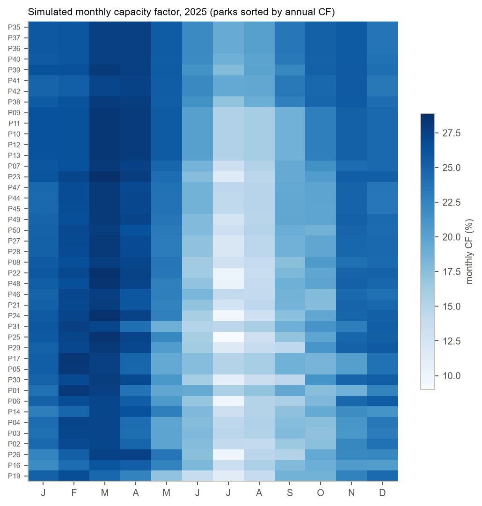
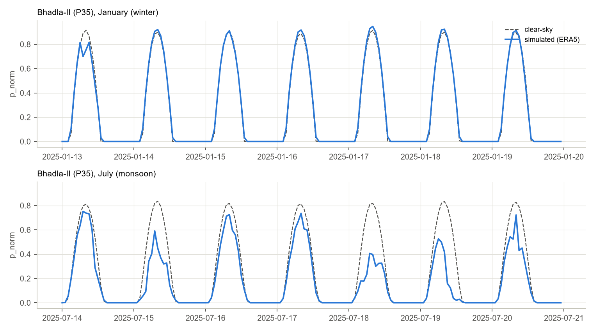
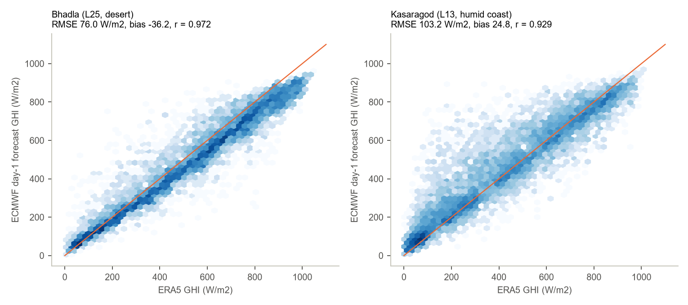

# Phase-1 Data Quality Report

Generated by `scripts/04_qc_report.py`. Study window 2024-04-01 to 2026-09-24 (UTC, hourly, interval-ending), 21,768 hours.

## Summary

- Weather locations: **36**; modelled parks: **43** (18 core, 25 virtual).
- ERA5 completeness: min **100.0%**; ECMWF day-1 forecast completeness: min **100.0%**.
- Physical-consistency flags (all locations): night GHI > 5 W/m2: **4460** h; GHI > 1.1 x top-of-atmosphere + 50: **0** h; DHI > GHI: **0** h.
- Simulated targets: max p_norm **1.0**, night-time non-zero hours **0**, missing **0.0%** (worst park).
- 2025 simulated capacity factor (AC basis, DC/AC 1.25): core parks **19.84-24.27%** (median 21.63%); all parks 19.84-24.27%.
- ECMWF day-1 GHI forecast vs ERA5 (daylight): RMSE **70.5-123.6 W/m2** (median 98.0), correlation 0.901-0.972.
- Hours where ERA5 GHI exceeds the Ineichen clear-sky GHI by >10% (sun > 15 deg): median **0.795%** of hours - the clear-sky index therefore needs capping or a data-driven clear-sky reference in Phase 2.

**Issues requiring action:** none blocking.

## Interpretation and caveats

1. These are **simulated** targets (pvlib + ERA5) and describe weather-driven potential output, not metered generation: no curtailment, outages or grid limits.
2. Capacity factors are on an **AC basis** with an assumed DC/AC ratio of 1.25; published Indian CUFs are often quoted on a different basis, so compare shapes, not levels, until measured data are available.
3. The NWP-vs-ERA5 comparison measures forecast error against reanalysis, not against ground measurements. It sets the realistic floor for forecast error when targets are simulated from ERA5.

## Target QC by park

| park_id | park_name | state | tier | capacity_mw | hours | missing_pct | cf_2025_pct | cf_clearsky_2025_pct | cf_monsoon_jjas_pct | cf_premonsoon_mam_pct | energy_2025_gwh | max_p_norm | clipped_daylight_pct | night_nonzero | k_gt_1p05_pct | ramp_hours_dk_gt_0p3 |
|---|---|---|---|---|---|---|---|---|---|---|---|---|---|---|---|---|
| P35 | Bhadla-II Solar Park | Rajasthan | U2_core | 680 | 21768 | 0.0 | 24.27 | 25.73 | 21.12 | 26.89 | 1445.6 | 1.0 | 0.05 | 0 | 5.43 | 82 |
| P37 | Bhadla-IV Solar Park | Rajasthan | U2_core | 500 | 21768 | 0.0 | 24.27 | 25.73 | 21.12 | 26.89 | 1062.9 | 1.0 | 0.05 | 0 | 5.43 | 82 |
| P36 | Bhadla-III Solar Park | Rajasthan | U2_core | 1000 | 21768 | 0.0 | 24.27 | 25.73 | 21.12 | 26.89 | 2125.8 | 1.0 | 0.05 | 0 | 5.43 | 82 |
| P40 | Nokh Solar Park | Rajasthan | U3_virtual | 925 | 21768 | 0.0 | 24.19 | 25.79 | 20.92 | 26.88 | 1959.9 | 1.0 | 0.05 | 0 | 4.45 | 67 |
| P39 | Fatehgarh Phase-1B Solar Park | Rajasthan | U2_core | 421 | 21768 | 0.0 | 24.16 | 25.72 | 20.26 | 27.1 | 890.9 | 1.0 | 0.04 | 0 | 7.15 | 62 |
| P41 | Pugal Solar Park Ph-I | Rajasthan | U3_virtual | 1000 | 21768 | 0.0 | 23.99 | 25.73 | 21.01 | 26.67 | 2101.2 | 1.0 | 0.04 | 0 | 3.76 | 72 |
| P42 | Pugal Solar Park Ph-II | Rajasthan | U3_virtual | 1000 | 21768 | 0.0 | 23.99 | 25.73 | 21.01 | 26.67 | 2101.2 | 1.0 | 0.04 | 0 | 3.76 | 72 |
| P38 | Phalodi-Pokaran Solar Park | Rajasthan | U2_core | 300 | 21768 | 0.0 | 23.94 | 25.95 | 19.97 | 27.02 | 629.1 | 1.0 | 0.06 | 0 | 4.73 | 82 |
| P09 | NTPC RE Park | Gujarat | U3_virtual | 4750 | 21768 | 0.0 | 23.06 | 25.68 | 17.48 | 27.29 | 9595.0 | 0.9949 | 0.03 | 0 | 6.58 | 42 |
| P11 | GIPCL RE Park Ph-I | Gujarat | U3_virtual | 600 | 21768 | 0.0 | 23.06 | 25.68 | 17.48 | 27.29 | 1212.0 | 0.9949 | 0.03 | 0 | 6.58 | 42 |
| P10 | GSECL RE Park | Gujarat | U3_virtual | 3325 | 21768 | 0.0 | 23.06 | 25.68 | 17.48 | 27.29 | 6716.5 | 0.9949 | 0.03 | 0 | 6.58 | 42 |
| P12 | GIPCL RE Park Ph-II | Gujarat | U3_virtual | 1200 | 21768 | 0.0 | 23.06 | 25.68 | 17.48 | 27.29 | 2424.0 | 0.9949 | 0.03 | 0 | 6.58 | 42 |
| P13 | GIPCL RE Park Ph-III | Gujarat | U3_virtual | 575 | 21768 | 0.0 | 23.06 | 25.68 | 17.48 | 27.29 | 1161.5 | 0.9949 | 0.03 | 0 | 6.58 | 42 |
| P07 | Radhnesada Solar Park | Gujarat | U2_core | 500 | 21768 | 0.0 | 22.39 | 25.45 | 16.51 | 26.81 | 980.7 | 0.9906 | 0.01 | 0 | 5.62 | 76 |
| P23 | Neemuch Solar Park | Madhya Pradesh | U3_virtual | 500 | 21768 | 0.0 | 22.28 | 26.59 | 15.65 | 26.92 | 975.9 | 1.0 | 0.06 | 0 | 2.88 | 115 |
| P47 | Kalpi Solar Park | Uttar Pradesh | U2_core | 26 | 21768 | 0.0 | 22.11 | 25.87 | 16.81 | 26.3 | 50.4 | 1.0 | 0.04 | 0 | 3.3 | 88 |
| P44 | Solar Park in UP (LSPDCL) | Uttar Pradesh | U2_core | 240 | 21768 | 0.0 | 22.08 | 25.87 | 16.74 | 26.3 | 464.1 | 1.0 | 0.04 | 0 | 3.34 | 157 |
| P45 | Jalaun Solar Park | Uttar Pradesh | U3_virtual | 1200 | 21768 | 0.0 | 22.07 | 25.88 | 16.74 | 26.3 | 2319.9 | 1.0 | 0.04 | 0 | 3.3 | 156 |
| P49 | Jhansi Solar Park | Uttar Pradesh | U3_virtual | 600 | 21768 | 0.0 | 21.99 | 25.84 | 16.13 | 26.33 | 1155.7 | 1.0 | 0.04 | 0 | 3.81 | 125 |
| P50 | Chitrakoot Solar Park | Uttar Pradesh | U3_virtual | 800 | 21768 | 0.0 | 21.79 | 25.99 | 16.2 | 25.8 | 1526.8 | 1.0 | 0.04 | 0 | 2.6 | 95 |
| P27 | Chhatarpur Solar Park | Madhya Pradesh | U3_virtual | 950 | 21768 | 0.0 | 21.7 | 26.12 | 15.54 | 25.93 | 1805.5 | 1.0 | 0.04 | 0 | 2.89 | 85 |
| P28 | Barethi Solar Park | Madhya Pradesh | U3_virtual | 630 | 21768 | 0.0 | 21.69 | 26.09 | 15.54 | 25.92 | 1196.9 | 1.0 | 0.04 | 0 | 2.91 | 86 |
| P08 | Dholera Solar Park | Gujarat | U2_core | 300 | 21768 | 0.0 | 21.64 | 25.82 | 15.09 | 26.14 | 568.8 | 0.9935 | 0.01 | 0 | 2.15 | 70 |
| P22 | Mandsaur Solar Park | Madhya Pradesh | U2_core | 250 | 21768 | 0.0 | 21.62 | 26.38 | 14.49 | 26.47 | 473.6 | 1.0 | 0.02 | 0 | 2.88 | 123 |
| P48 | Lalitpur Solar Park | Uttar Pradesh | U3_virtual | 600 | 21768 | 0.0 | 21.62 | 26.23 | 14.95 | 26.18 | 1136.3 | 1.0 | 0.04 | 0 | 3.09 | 140 |
| P46 | Mirzapur Solar Park | Uttar Pradesh | U3_virtual | 100 | 21768 | 0.0 | 21.59 | 26.21 | 16.22 | 25.47 | 189.1 | 1.0 | 0.07 | 0 | 2.13 | 123 |
| P21 | Rewa Ultra Mega Solar Park | Madhya Pradesh | U2_core | 750 | 21768 | 0.0 | 21.47 | 26.35 | 15.58 | 25.45 | 1410.9 | 1.0 | 0.05 | 0 | 2.09 | 129 |
| P24 | Agar Solar Park | Madhya Pradesh | U3_virtual | 550 | 21768 | 0.0 | 21.38 | 26.59 | 13.89 | 26.26 | 1030.3 | 1.0 | 0.02 | 0 | 2.61 | 123 |
| P31 | Vankal Solar Park | Mizoram | U2_core | 20 | 21768 | 0.0 | 21.37 | 28.68 | 16.02 | 23.35 | 37.4 | 1.0 | 0.09 | 0 | 0.74 | 213 |
| P25 | Shajapur Solar Park | Madhya Pradesh | U3_virtual | 450 | 21768 | 0.0 | 21.25 | 26.49 | 13.68 | 25.99 | 837.5 | 1.0 | 0.02 | 0 | 2.83 | 164 |
| P29 | Sai Guru Solar Park | Maharashtra | U3_virtual | 500 | 21768 | 0.0 | 21.23 | 26.61 | 13.89 | 25.2 | 930.0 | 0.9919 | 0.01 | 0 | 2.09 | 33 |
| P17 | Pavagada Solar Park | Karnataka | U2_core | 2000 | 21768 | 0.0 | 21.22 | 26.74 | 16.8 | 23.92 | 3717.5 | 0.9816 | 0.0 | 0 | 2.03 | 118 |
| P05 | Ramagiri Solar Park | Andhra Pradesh | U3_virtual | 300 | 21768 | 0.0 | 21.2 | 26.61 | 16.78 | 23.89 | 557.0 | 0.9807 | 0.0 | 0 | 2.28 | 122 |
| P30 | Dondaicha Solar Park | Maharashtra | U3_virtual | 250 | 21768 | 0.0 | 21.11 | 25.93 | 13.7 | 25.19 | 462.3 | 0.9798 | 0.0 | 0 | 2.96 | 55 |
| P01 | Ananthapuramu-I Solar Park (NP Kunta) | Andhra Pradesh | U2_core | 1400 | 21768 | 0.0 | 21.03 | 26.36 | 17.83 | 23.63 | 2579.7 | 0.9791 | 0.0 | 0 | 2.59 | 110 |
| P06 | Rajnandgaon Solar Park | Chhattisgarh | U3_virtual | 100 | 21768 | 0.0 | 20.86 | 26.12 | 14.35 | 24.43 | 182.7 | 0.9883 | 0.0 | 0 | 2.05 | 98 |
| P14 | SECI Floating Solar Park | Jharkhand | U3_virtual | 100 | 21768 | 0.0 | 20.78 | 26.67 | 15.85 | 25.4 | 182.0 | 1.0 | 0.05 | 0 | 1.58 | 172 |
| P04 | Ananthapuramu-II Solar Park | Andhra Pradesh | U2_core | 500 | 21768 | 0.0 | 20.75 | 26.01 | 16.24 | 23.71 | 908.8 | 0.9527 | 0.0 | 0 | 2.11 | 149 |
| P03 | Kadapa Solar Park | Andhra Pradesh | U2_core | 250 | 21768 | 0.0 | 20.71 | 25.95 | 16.4 | 23.7 | 453.6 | 0.9535 | 0.0 | 0 | 2.32 | 129 |
| P02 | Kurnool Ultra Mega Solar Park | Andhra Pradesh | U2_core | 1000 | 21768 | 0.0 | 20.7 | 26.24 | 15.57 | 23.88 | 1813.3 | 0.9503 | 0.0 | 0 | 1.57 | 97 |
| P26 | Omkareshwar Floating Solar Park | Madhya Pradesh | U3_virtual | 600 | 21768 | 0.0 | 20.55 | 25.68 | 14.28 | 26.17 | 1080.2 | 0.9853 | 0.0 | 0 | 3.74 | 77 |
| P16 | DVC Floating Solar Park Ph-II | Jharkhand | U3_virtual | 234 | 21768 | 0.0 | 20.35 | 25.65 | 16.21 | 24.57 | 417.1 | 0.9788 | 0.0 | 0 | 1.69 | 140 |
| P19 | Kasargod Solar Park | Kerala | U2_core | 100 | 21768 | 0.0 | 19.84 | 26.61 | 14.3 | 21.36 | 173.8 | 0.9427 | 0.0 | 0 | 0.51 | 97 |

## NWP forecast vs ERA5 (GHI, daylight hours)

| loc_id | state | lead | n | bias_wm2 | mae_wm2 | rmse_wm2 | corr | nrmse_pct_of_mean |
|---|---|---|---|---|---|---|---|---|
| L27 | Rajasthan | d1 | 10456 | -21.5 | 48.2 | 70.5 | 0.971 | 14.0 |
| L09 | Gujarat | d1 | 10437 | 6.9 | 45.1 | 71.4 | 0.966 | 14.9 |
| L29 | Rajasthan | d1 | 10440 | -37.0 | 57.6 | 75.6 | 0.972 | 15.1 |
| L28 | Rajasthan | d1 | 10455 | -35.2 | 57.0 | 75.8 | 0.971 | 15.1 |
| L25 | Rajasthan | d1 | 10449 | -36.2 | 57.3 | 76.0 | 0.972 | 15.0 |
| L07 | Gujarat | d1 | 10485 | 5.7 | 50.0 | 77.8 | 0.961 | 16.6 |
| L26 | Rajasthan | d1 | 10475 | -29.8 | 56.9 | 78.8 | 0.966 | 15.9 |
| L08 | Gujarat | d1 | 10417 | 19.0 | 50.5 | 84.6 | 0.955 | 18.7 |
| L16 | Madhya Pradesh | d1 | 10302 | 13.6 | 58.0 | 91.6 | 0.944 | 20.2 |
| L33 | Uttar Pradesh | d1 | 10403 | 3.8 | 64.2 | 94.9 | 0.935 | 21.3 |
| L15 | Madhya Pradesh | d1 | 10305 | 20.4 | 60.8 | 95.9 | 0.94 | 21.7 |
| L22 | Maharashtra | d1 | 10338 | 32.6 | 57.9 | 96.0 | 0.945 | 21.8 |
| L30 | Uttar Pradesh | d1 | 10401 | 2.9 | 65.7 | 96.8 | 0.933 | 21.7 |
| L31 | Uttar Pradesh | d1 | 10401 | 2.9 | 65.7 | 96.8 | 0.933 | 21.7 |
| L32 | Uttar Pradesh | d1 | 10412 | 10.7 | 65.9 | 97.0 | 0.933 | 22.1 |
| L36 | Uttar Pradesh | d1 | 10407 | 11.9 | 66.0 | 97.9 | 0.932 | 22.2 |
| L17 | Madhya Pradesh | d1 | 10306 | 24.4 | 61.3 | 98.0 | 0.939 | 22.5 |
| L20 | Madhya Pradesh | d1 | 10404 | 18.1 | 64.2 | 98.0 | 0.935 | 22.4 |
| L21 | Madhya Pradesh | d1 | 10407 | 18.1 | 64.2 | 98.0 | 0.935 | 22.4 |
| L10 | Jharkhand | d1 | 10496 | 25.9 | 64.2 | 99.0 | 0.934 | 23.4 |
| L35 | Uttar Pradesh | d1 | 10397 | 9.8 | 65.8 | 99.1 | 0.931 | 22.3 |
| L11 | Jharkhand | d1 | 10468 | 19.0 | 66.5 | 99.6 | 0.928 | 23.5 |
| L06 | Chhattisgarh | d1 | 10413 | 34.0 | 63.6 | 100.4 | 0.939 | 23.7 |
| L14 | Madhya Pradesh | d1 | 10409 | 21.2 | 67.1 | 101.7 | 0.93 | 23.4 |
| L13 | Kerala | d1 | 10444 | 24.8 | 68.4 | 103.2 | 0.929 | 24.9 |
| L34 | Uttar Pradesh | d1 | 10407 | 18.8 | 67.4 | 105.4 | 0.926 | 24.2 |
| L19 | Madhya Pradesh | d1 | 10322 | 27.4 | 66.2 | 105.7 | 0.929 | 24.2 |
| L23 | Maharashtra | d1 | 10334 | 33.2 | 65.0 | 105.7 | 0.932 | 24.1 |
| L03 | Andhra Pradesh | d1 | 10382 | 37.5 | 69.6 | 107.3 | 0.929 | 23.9 |
| L02 | Andhra Pradesh | d1 | 10371 | 37.7 | 69.7 | 107.9 | 0.928 | 24.3 |
| L18 | Madhya Pradesh | d1 | 10306 | 29.3 | 67.6 | 108.0 | 0.926 | 24.9 |
| L01 | Andhra Pradesh | d1 | 10393 | 38.8 | 69.7 | 109.2 | 0.931 | 23.9 |
| L04 | Andhra Pradesh | d1 | 10386 | 39.4 | 69.7 | 109.4 | 0.928 | 24.3 |
| L05 | Andhra Pradesh | d1 | 10402 | 42.1 | 70.9 | 111.0 | 0.929 | 24.4 |
| L12 | Karnataka | d1 | 10403 | 42.1 | 70.9 | 111.0 | 0.929 | 24.4 |
| L24 | Mizoram | d1 | 10402 | 51.0 | 81.5 | 123.6 | 0.901 | 30.3 |
| L27 | Rajasthan | d2 | 10456 | -21.7 | 49.6 | 72.4 | 0.969 | 14.4 |
| L09 | Gujarat | d2 | 10437 | 6.6 | 46.8 | 76.8 | 0.96 | 16.0 |
| L28 | Rajasthan | d2 | 10455 | -34.0 | 57.6 | 77.1 | 0.969 | 15.3 |
| L25 | Rajasthan | d2 | 10449 | -35.1 | 57.5 | 77.4 | 0.97 | 15.3 |
| L29 | Rajasthan | d2 | 10440 | -36.6 | 58.8 | 78.2 | 0.969 | 15.6 |
| L07 | Gujarat | d2 | 10485 | 5.4 | 49.2 | 79.9 | 0.958 | 17.0 |
| L26 | Rajasthan | d2 | 10475 | -29.2 | 57.3 | 80.5 | 0.963 | 16.2 |
| L08 | Gujarat | d2 | 10417 | 20.4 | 52.1 | 89.1 | 0.95 | 19.7 |
| L33 | Uttar Pradesh | d2 | 10403 | -0.4 | 63.9 | 93.3 | 0.937 | 20.9 |
| L16 | Madhya Pradesh | d2 | 10302 | 12.0 | 59.0 | 93.9 | 0.94 | 20.7 |
| L30 | Uttar Pradesh | d2 | 10401 | -1.3 | 65.8 | 96.4 | 0.934 | 21.6 |
| L31 | Uttar Pradesh | d2 | 10401 | -1.3 | 65.8 | 96.4 | 0.934 | 21.6 |
| L36 | Uttar Pradesh | d2 | 10407 | 11.6 | 65.7 | 96.6 | 0.934 | 21.9 |
| L35 | Uttar Pradesh | d2 | 10397 | 6.8 | 64.9 | 96.8 | 0.934 | 21.8 |
| L20 | Madhya Pradesh | d2 | 10404 | 16.6 | 63.6 | 98.0 | 0.934 | 22.4 |
| L21 | Madhya Pradesh | d2 | 10407 | 16.6 | 63.6 | 98.0 | 0.934 | 22.4 |
| L15 | Madhya Pradesh | d2 | 10305 | 21.4 | 62.0 | 98.5 | 0.937 | 22.3 |
| L32 | Uttar Pradesh | d2 | 10412 | 11.2 | 67.3 | 99.9 | 0.929 | 22.7 |
| L22 | Maharashtra | d2 | 10338 | 33.7 | 59.4 | 100.4 | 0.94 | 22.9 |
| L17 | Madhya Pradesh | d2 | 10306 | 25.4 | 62.5 | 101.0 | 0.935 | 23.1 |
| L14 | Madhya Pradesh | d2 | 10409 | 20.6 | 66.4 | 101.9 | 0.929 | 23.4 |
| L34 | Uttar Pradesh | d2 | 10407 | 18.5 | 66.3 | 103.2 | 0.929 | 23.7 |
| L11 | Jharkhand | d2 | 10468 | 21.4 | 69.0 | 103.6 | 0.923 | 24.4 |
| L23 | Maharashtra | d2 | 10334 | 33.4 | 64.0 | 105.8 | 0.932 | 24.1 |
| L06 | Chhattisgarh | d2 | 10413 | 34.4 | 66.5 | 106.4 | 0.931 | 25.1 |
| L10 | Jharkhand | d2 | 10496 | 27.6 | 68.0 | 106.4 | 0.923 | 25.1 |
| L13 | Kerala | d2 | 10444 | 27.6 | 70.6 | 107.0 | 0.924 | 25.9 |
| L18 | Madhya Pradesh | d2 | 10306 | 28.1 | 67.1 | 107.3 | 0.927 | 24.7 |
| L19 | Madhya Pradesh | d2 | 10322 | 25.4 | 68.2 | 109.0 | 0.924 | 24.9 |
| L02 | Andhra Pradesh | d2 | 10371 | 38.4 | 70.8 | 110.0 | 0.925 | 24.8 |
| L03 | Andhra Pradesh | d2 | 10382 | 38.3 | 72.2 | 112.2 | 0.922 | 25.0 |
| L01 | Andhra Pradesh | d2 | 10393 | 40.2 | 72.8 | 112.9 | 0.926 | 24.7 |
| L04 | Andhra Pradesh | d2 | 10386 | 38.8 | 72.9 | 114.9 | 0.919 | 25.5 |
| L05 | Andhra Pradesh | d2 | 10402 | 42.6 | 75.4 | 116.8 | 0.92 | 25.6 |
| L12 | Karnataka | d2 | 10403 | 42.5 | 75.3 | 116.8 | 0.92 | 25.6 |
| L24 | Mizoram | d2 | 10402 | 51.9 | 84.4 | 128.7 | 0.891 | 31.6 |

## Weather QC by location

| loc_id | dataset | hours | expected | completeness_pct | any_var_missing_pct | night_ghi_gt5 | ghi_gt_1p1_toa | dhi_gt_ghi | clear_sky_index_gt_1p1_pct | grid_lat | grid_lon | elevation_m |
|---|---|---|---|---|---|---|---|---|---|---|---|---|
| L01 | era5 | 21768 | 21768 | 100.0 | 0.0 | 56 | 0 | 0 | 1.44 | 14.0 | 78.5 | 431.0 |
| L01 | fc_ecmwf_d1 | 21768 | 21768 | 100.0 | 0.59 | 192 | 0 | 0 | 1.94 | 14.0 | 78.5 | 431.0 |
| L02 | era5 | 21768 | 21768 | 100.0 | 0.0 | 21 | 0 | 0 | 0.44 | 15.75 | 78.25 | 288.0 |
| L02 | fc_ecmwf_d1 | 21768 | 21768 | 100.0 | 0.59 | 150 | 0 | 0 | 1.3 | 15.75 | 78.25 | 288.0 |
| L03 | era5 | 21768 | 21768 | 100.0 | 0.0 | 28 | 0 | 0 | 1.09 | 15.0 | 78.25 | 234.0 |
| L03 | fc_ecmwf_d1 | 21768 | 21768 | 100.0 | 0.59 | 163 | 0 | 0 | 1.31 | 15.0 | 78.25 | 234.0 |
| L04 | era5 | 21768 | 21768 | 100.0 | 0.0 | 14 | 0 | 0 | 0.98 | 15.0 | 78.0 | 238.0 |
| L04 | fc_ecmwf_d1 | 21768 | 21768 | 100.0 | 0.59 | 196 | 0 | 0 | 1.36 | 15.0 | 78.0 | 238.0 |
| L05 | era5 | 21768 | 21768 | 100.0 | 0.0 | 21 | 0 | 0 | 1.38 | 14.25 | 77.5 | 524.0 |
| L05 | fc_ecmwf_d1 | 21768 | 21768 | 100.0 | 0.59 | 271 | 0 | 0 | 1.18 | 14.25 | 77.5 | 524.0 |
| L06 | era5 | 21768 | 21768 | 100.0 | 0.0 | 10 | 0 | 0 | 0.8 | 21.0 | 80.75 | 338.0 |
| L06 | fc_ecmwf_d1 | 21768 | 21768 | 100.0 | 0.59 | 63 | 0 | 0 | 1.25 | 21.0 | 80.75 | 338.0 |
| L07 | era5 | 21768 | 21768 | 100.0 | 0.0 | 15 | 0 | 0 | 1.21 | 24.25 | 71.5 | 56.0 |
| L07 | fc_ecmwf_d1 | 21768 | 21768 | 100.0 | 0.59 | 74 | 0 | 0 | 0.17 | 24.25 | 71.5 | 56.0 |
| L08 | era5 | 21768 | 21768 | 100.0 | 0.0 | 15 | 0 | 0 | 0.13 | 22.25 | 72.25 | 15.0 |
| L08 | fc_ecmwf_d1 | 21768 | 21768 | 100.0 | 0.59 | 94 | 0 | 0 | 0.06 | 22.25 | 72.25 | 15.0 |
| L09 | era5 | 21768 | 21768 | 100.0 | 0.0 | 14 | 0 | 0 | 2.26 | 24.0 | 69.25 | 4.0 |
| L09 | fc_ecmwf_d1 | 21768 | 21768 | 100.0 | 0.59 | 83 | 0 | 0 | 0.55 | 24.0 | 69.25 | 4.0 |
| L10 | era5 | 21768 | 21768 | 100.0 | 0.0 | 10 | 0 | 0 | 0.29 | 23.5 | 85.5 | 597.0 |
| L10 | fc_ecmwf_d1 | 21768 | 21768 | 100.0 | 0.59 | 90 | 0 | 0 | 0.68 | 23.5 | 85.5 | 597.0 |
| L11 | era5 | 21768 | 21768 | 100.0 | 0.0 | 6 | 0 | 0 | 0.19 | 23.75 | 86.75 | 125.0 |
| L11 | fc_ecmwf_d1 | 21768 | 21768 | 100.0 | 0.59 | 60 | 0 | 0 | 0.27 | 23.75 | 86.75 | 125.0 |
| L12 | era5 | 21768 | 21768 | 100.0 | 0.0 | 21 | 0 | 0 | 1.04 | 14.25 | 77.5 | 572.0 |
| L12 | fc_ecmwf_d1 | 21768 | 21768 | 100.0 | 0.59 | 276 | 0 | 0 | 0.94 | 14.25 | 77.5 | 572.0 |
| L13 | era5 | 21768 | 21768 | 100.0 | 0.0 | 2 | 0 | 0 | 0.15 | 12.25 | 75.25 | 93.0 |
| L13 | fc_ecmwf_d1 | 21768 | 21768 | 100.0 | 0.59 | 64 | 0 | 0 | 0.03 | 12.25 | 75.25 | 93.0 |
| L14 | era5 | 21768 | 21768 | 100.0 | 0.0 | 8 | 0 | 0 | 0.63 | 24.5 | 81.5 | 371.0 |
| L14 | fc_ecmwf_d1 | 21768 | 21768 | 100.0 | 0.59 | 56 | 0 | 0 | 0.61 | 24.5 | 81.5 | 371.0 |
| L15 | era5 | 21768 | 21768 | 100.0 | 0.0 | 21 | 0 | 0 | 0.59 | 24.25 | 75.5 | 386.0 |
| L15 | fc_ecmwf_d1 | 21768 | 21768 | 100.0 | 0.59 | 110 | 0 | 0 | 1.05 | 24.25 | 75.5 | 386.0 |
| L16 | era5 | 21768 | 21768 | 100.0 | 0.0 | 22 | 0 | 0 | 0.51 | 24.75 | 75.25 | 484.0 |
| L16 | fc_ecmwf_d1 | 21768 | 21768 | 100.0 | 0.59 | 114 | 0 | 0 | 0.68 | 24.75 | 75.25 | 484.0 |
| L17 | era5 | 21768 | 21768 | 100.0 | 0.0 | 16 | 0 | 0 | 0.53 | 23.75 | 76.0 | 512.0 |
| L17 | fc_ecmwf_d1 | 21768 | 21768 | 100.0 | 0.59 | 109 | 0 | 0 | 1.01 | 23.75 | 76.0 | 512.0 |
| L18 | era5 | 21768 | 21768 | 100.0 | 0.0 | 14 | 0 | 0 | 0.51 | 23.5 | 76.5 | 460.0 |
| L18 | fc_ecmwf_d1 | 21768 | 21768 | 100.0 | 0.59 | 139 | 0 | 0 | 0.82 | 23.5 | 76.5 | 460.0 |
| L19 | era5 | 21768 | 21768 | 100.0 | 0.0 | 41 | 0 | 0 | 0.95 | 22.25 | 76.25 | 156.0 |
| L19 | fc_ecmwf_d1 | 21768 | 21768 | 100.0 | 0.59 | 135 | 0 | 0 | 1.27 | 22.25 | 76.25 | 156.0 |
| L20 | era5 | 21768 | 21768 | 100.0 | 0.0 | 6 | 0 | 0 | 0.71 | 24.75 | 79.75 | 289.0 |
| L20 | fc_ecmwf_d1 | 21768 | 21768 | 100.0 | 0.59 | 63 | 0 | 0 | 0.53 | 24.75 | 79.75 | 289.0 |
| L21 | era5 | 21768 | 21768 | 100.0 | 0.0 | 6 | 0 | 0 | 0.79 | 24.75 | 79.75 | 273.0 |
| L21 | fc_ecmwf_d1 | 21768 | 21768 | 100.0 | 0.59 | 63 | 0 | 0 | 0.53 | 24.75 | 79.75 | 273.0 |
| L22 | era5 | 21768 | 21768 | 100.0 | 0.0 | 35 | 0 | 0 | 0.2 | 21.0 | 74.25 | 422.0 |
| L22 | fc_ecmwf_d1 | 21768 | 21768 | 100.0 | 0.59 | 192 | 0 | 0 | 0.53 | 21.0 | 74.25 | 422.0 |
| L23 | era5 | 21768 | 21768 | 100.0 | 0.0 | 33 | 0 | 0 | 0.48 | 21.25 | 74.5 | 163.0 |
| L23 | fc_ecmwf_d1 | 21768 | 21768 | 100.0 | 0.59 | 193 | 0 | 0 | 0.42 | 21.25 | 74.5 | 163.0 |
| L24 | era5 | 21768 | 21768 | 100.0 | 0.0 | 9 | 0 | 0 | 0.0 | 23.5 | 93.25 | 1270.0 |
| L24 | fc_ecmwf_d1 | 21768 | 21768 | 100.0 | 0.59 | 99 | 0 | 0 | 0.3 | 23.5 | 93.25 | 1270.0 |
| L25 | era5 | 21768 | 21768 | 100.0 | 0.0 | 12 | 0 | 0 | 1.18 | 27.5 | 72.0 | 170.0 |
| L25 | fc_ecmwf_d1 | 21768 | 21768 | 100.0 | 0.59 | 88 | 0 | 0 | 0.0 | 27.5 | 72.0 | 170.0 |
| L26 | era5 | 21768 | 21768 | 100.0 | 0.0 | 15 | 0 | 0 | 1.04 | 27.0 | 72.5 | 269.0 |
| L26 | fc_ecmwf_d1 | 21768 | 21768 | 100.0 | 0.59 | 90 | 0 | 0 | 0.01 | 27.0 | 72.5 | 269.0 |
| L27 | era5 | 21768 | 21768 | 100.0 | 0.0 | 18 | 0 | 0 | 2.13 | 26.5 | 71.25 | 260.0 |
| L27 | fc_ecmwf_d1 | 21768 | 21768 | 100.0 | 0.59 | 112 | 0 | 0 | 0.03 | 26.5 | 71.25 | 260.0 |
| L28 | era5 | 21768 | 21768 | 100.0 | 0.0 | 12 | 0 | 0 | 0.83 | 27.5 | 72.25 | 175.0 |
| L28 | fc_ecmwf_d1 | 21768 | 21768 | 100.0 | 0.59 | 81 | 0 | 0 | 0.0 | 27.5 | 72.25 | 175.0 |
| L29 | era5 | 21768 | 21768 | 100.0 | 0.0 | 10 | 0 | 0 | 0.38 | 28.5 | 72.75 | 148.0 |
| L29 | fc_ecmwf_d1 | 21768 | 21768 | 100.0 | 0.59 | 61 | 0 | 0 | 0.0 | 28.5 | 72.75 | 148.0 |
| L30 | era5 | 21768 | 21768 | 100.0 | 0.0 | 6 | 0 | 0 | 0.86 | 26.0 | 79.5 | 142.0 |
| L30 | fc_ecmwf_d1 | 21768 | 21768 | 100.0 | 0.59 | 57 | 0 | 0 | 0.37 | 26.0 | 79.5 | 142.0 |
| L31 | era5 | 21768 | 21768 | 100.0 | 0.0 | 6 | 0 | 0 | 0.9 | 26.0 | 79.5 | 144.0 |
| L31 | fc_ecmwf_d1 | 21768 | 21768 | 100.0 | 0.59 | 56 | 0 | 0 | 0.36 | 26.0 | 79.5 | 144.0 |
| L32 | era5 | 21768 | 21768 | 100.0 | 0.0 | 7 | 0 | 0 | 0.51 | 25.0 | 82.75 | 240.0 |
| L32 | fc_ecmwf_d1 | 21768 | 21768 | 100.0 | 0.59 | 87 | 0 | 0 | 0.32 | 25.0 | 82.75 | 240.0 |
| L33 | era5 | 21768 | 21768 | 100.0 | 0.0 | 5 | 0 | 0 | 0.92 | 26.0 | 79.75 | 128.0 |
| L33 | fc_ecmwf_d1 | 21768 | 21768 | 100.0 | 0.59 | 51 | 0 | 0 | 0.34 | 26.0 | 79.75 | 128.0 |
| L34 | era5 | 21768 | 21768 | 100.0 | 0.0 | 3 | 0 | 0 | 0.8 | 24.75 | 78.5 | 361.0 |
| L34 | fc_ecmwf_d1 | 21768 | 21768 | 100.0 | 0.59 | 72 | 0 | 0 | 0.46 | 24.75 | 78.5 | 361.0 |
| L35 | era5 | 21768 | 21768 | 100.0 | 0.0 | 7 | 0 | 0 | 1.15 | 25.5 | 78.75 | 202.0 |
| L35 | fc_ecmwf_d1 | 21768 | 21768 | 100.0 | 0.59 | 56 | 0 | 0 | 0.48 | 25.5 | 78.75 | 202.0 |
| L36 | era5 | 21768 | 21768 | 100.0 | 0.0 | 6 | 0 | 0 | 0.7 | 25.25 | 81.0 | 133.0 |
| L36 | fc_ecmwf_d1 | 21768 | 21768 | 100.0 | 0.59 | 49 | 0 | 0 | 0.39 | 25.25 | 81.0 | 133.0 |

## Figures

