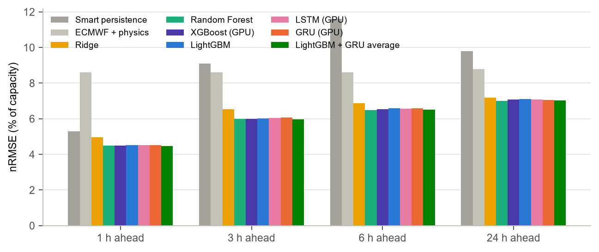
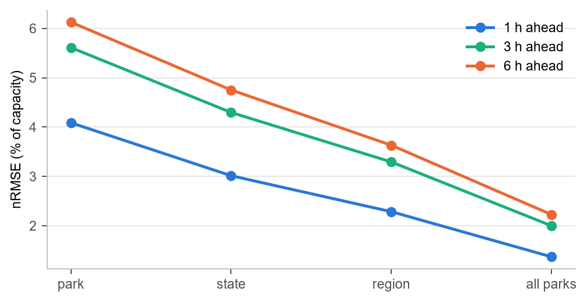
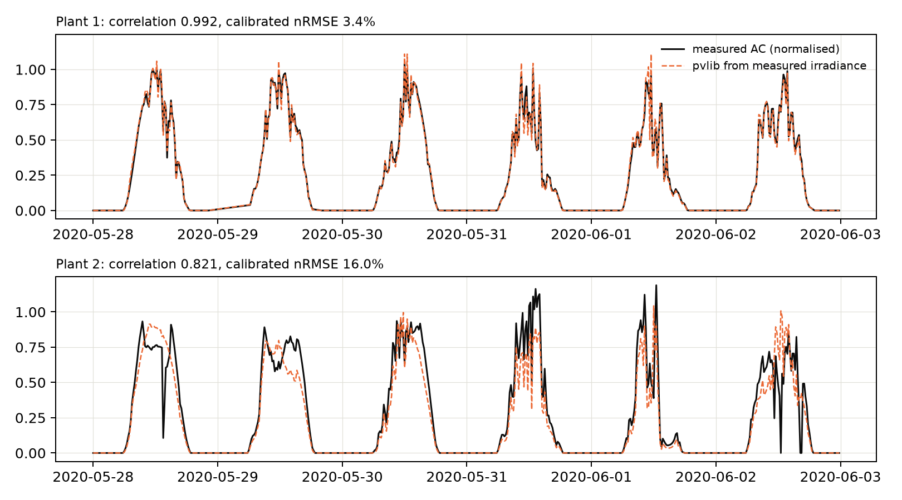
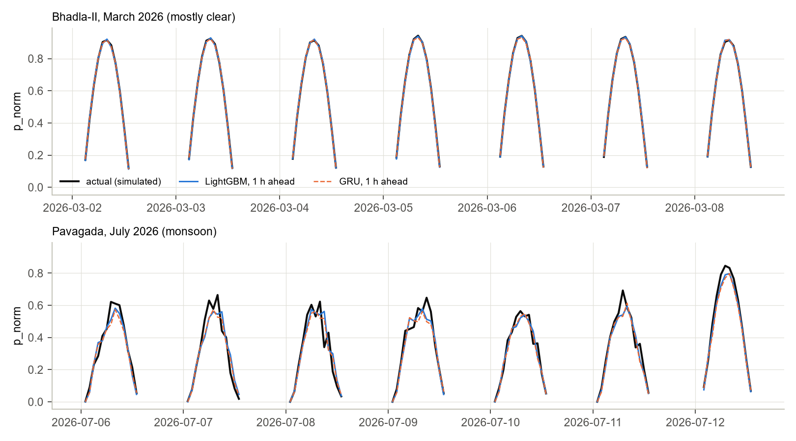

# Forecasting Results (test period Jan-Sep 2026, daylight hours)

All errors are **% of park capacity** (normalised power). Skill = improvement in RMSE over smart persistence. Targets are pvlib-simulated from ERA5; model inputs are day-old ECMWF forecasts (see docs/DECISIONS.md).

## E1 - Model comparison (all 43 parks)

| model | nRMSE 1h | nRMSE 3h | nRMSE 6h | nRMSE 24h | skill 1h | skill 3h | skill 6h | skill 24h |
|---|---|---|---|---|---|---|---|---|
| LightGBM + GRU average | 4.47 | 5.98 | 6.52 | 7.02 | 0.15 | 0.34 | 0.44 | 0.28 |
| Random Forest | 4.50 | 5.99 | 6.49 | 7.00 | 0.15 | 0.34 | 0.44 | 0.28 |
| XGBoost (GPU) | 4.50 | 5.99 | 6.54 | 7.09 | 0.15 | 0.34 | 0.44 | 0.28 |
| GRU (GPU) | 4.52 | 6.07 | 6.59 | 7.06 | 0.14 | 0.33 | 0.43 | 0.28 |
| LightGBM | 4.53 | 6.02 | 6.59 | 7.10 | 0.14 | 0.34 | 0.43 | 0.27 |
| LSTM (GPU) | 4.53 | 6.05 | 6.57 | 7.09 | 0.14 | 0.33 | 0.43 | 0.28 |
| Ridge | 4.95 | 6.53 | 6.88 | 7.18 | 0.06 | 0.28 | 0.41 | 0.27 |
| Smart persistence | 5.28 | 9.09 | 11.61 | 9.79 | 0.00 | 0.00 | 0.00 | 0.00 |
| ECMWF + physics | 8.61 | 8.61 | 8.61 | 8.78 | -0.63 | 0.05 | 0.26 | 0.10 |
| Climatology | 9.82 | 9.82 | 9.82 | 9.82 | -0.86 | -0.08 | 0.15 | -0.00 |
| Persistence | 14.80 | 36.81 | 52.51 | 9.68 | -1.80 | -3.05 | -3.52 | 0.01 |

## E2 - One global model vs one model per park (mean park nRMSE)

| h | per_park | global_model | global_wins | parks |
|---|---|---|---|---|
| 1 | 4.67 | 4.43 | 43 | 43 |
| 3 | 6.19 | 5.92 | 43 | 43 |
| 6 | 6.72 | 6.48 | 42 | 43 |

## E3 - Regional models vs global model

| h | regional_nRMSE_% | global_nRMSE_% |
|---|---|---|
| 1 | 5.35 | 5.21 |
| 3 | 6.89 | 6.74 |
| 6 | 7.49 | 7.36 |

## E3b - Climate-zone models (Koppen-Geiger, weather clusters) vs global model

| h | grouping | group_models_nRMSE_% | global_nRMSE_% | groups | global_wins |
|---|---|---|---|---|---|
| 1 | Koppen-Geiger | 4.53 | 4.45 | 8 | 8 |
| 1 | weather clusters (k=5) | 4.51 | 4.44 | 5 | 5 |
| 3 | Koppen-Geiger | 6.02 | 5.94 | 8 | 7 |
| 3 | weather clusters (k=5) | 6.00 | 5.94 | 5 | 4 |
| 6 | Koppen-Geiger | 6.55 | 6.50 | 8 | 6 |
| 6 | weather clusters (k=5) | 6.54 | 6.49 | 5 | 3 |

## E4 - Which inputs matter (nRMSE by horizon)

| inputs | 1 | 3 | 6 |
|---|---|---|---|
| full (all inputs) | 4.53 | 6.02 | 6.59 |
| no NWP forecast (history only) | 4.66 | 6.65 | 7.80 |
| no park metadata | 4.52 | 6.02 | 6.58 |
| no recent power (weather only) | 7.02 | 7.02 | 7.02 |

## E4 - Share of model attribution by input group (SHAP, %)

| group | 1 | 3 | 6 |
|---|---|---|---|
| NWP forecast | 53.87 | 65.06 | 70.69 |
| park metadata | 1.14 | 2.42 | 2.84 |
| recent power | 36.38 | 24.19 | 19.12 |
| sun position & time | 8.61 | 8.33 | 7.36 |

## E5 - Error when parks are added together (capacity-normalised nRMSE)

| h | subset | model | park | state | region | all parks |
|---|---|---|---|---|---|---|
| 1 | all 43 parks | lightgbm | 4.09 | 3.01 | 2.29 | 1.37 |
| 1 | all 43 parks | bl_smart | 4.82 | 3.71 | 2.90 | 1.96 |
| 1 | 18 core parks | lightgbm | 4.43 | 3.57 | 2.96 | 1.88 |
| 1 | 18 core parks | bl_smart | 5.23 | 4.36 | 3.70 | 2.52 |
| 3 | all 43 parks | lightgbm | 5.61 | 4.30 | 3.29 | 2.00 |
| 3 | all 43 parks | bl_smart | 8.66 | 7.07 | 5.63 | 3.88 |
| 3 | 18 core parks | lightgbm | 5.97 | 4.91 | 4.14 | 2.67 |
| 3 | 18 core parks | bl_smart | 9.20 | 7.96 | 6.99 | 4.78 |
| 6 | all 43 parks | lightgbm | 6.13 | 4.75 | 3.63 | 2.23 |
| 6 | all 43 parks | bl_smart | 11.01 | 9.09 | 7.15 | 4.83 |
| 6 | 18 core parks | lightgbm | 6.49 | 5.40 | 4.57 | 2.95 |
| 6 | 18 core parks | bl_smart | 11.57 | 10.14 | 8.95 | 6.04 |
| 24 | all 43 parks | lightgbm | 6.64 | 5.26 | 4.04 | 2.56 |
| 24 | all 43 parks | bl_smart | 9.26 | 7.53 | 5.63 | 3.32 |
| 24 | 18 core parks | lightgbm | 6.87 | 5.81 | 4.97 | 3.26 |
| 24 | 18 core parks | bl_smart | 9.33 | 7.99 | 6.89 | 4.32 |

## E5 - Correlation of 1-h forecast errors vs distance between parks

| band_km | mean | count |
|---|---|---|
| (0, 100] | 0.62 | 22 |
| (100, 300] | 0.17 | 62 |
| (300, 600] | 0.02 | 123 |
| (600, 1000] | 0.01 | 172 |
| (1000, 1500] | 0.00 | 187 |
| (1500, 3000] | -0.01 | 64 |

## E6 - Ramps and weather regimes

| h | condition | share_% | lightgbm_nRMSE_% | smart_nRMSE_% |
|---|---|---|---|---|
| 1 | all daylight hours | 100.00 | 4.97 | 5.51 |
| 1 | ramp hours (|dk|>0.3) | 0.95 | 21.79 | 27.14 |
| 1 | non-ramp hours | 99.05 | 4.52 | 4.86 |
| 1 | clear days | 71.31 | 3.21 | 3.60 |
| 1 | partly cloudy days | 25.62 | 7.91 | 8.82 |
| 1 | overcast days | 3.07 | 6.71 | 6.37 |
| 1 | monsoon | 44.38 | 6.27 | 6.84 |
| 1 | non-monsoon | 55.62 | 3.62 | 4.16 |
| 1 | ramp detection: POD=0.04 FAR=0.89 CSI=0.03 | nan | nan | nan |
| 3 | all daylight hours | 100.00 | 6.63 | 9.95 |
| 3 | ramp hours (|dk|>0.3) | 0.95 | 18.68 | 24.89 |
| 3 | non-ramp hours | 99.05 | 6.41 | 9.70 |
| 3 | clear days | 71.31 | 4.37 | 7.82 |
| 3 | partly cloudy days | 25.62 | 10.29 | 14.17 |
| 3 | overcast days | 3.07 | 10.29 | 11.40 |
| 3 | monsoon | 44.38 | 8.31 | 10.94 |
| 3 | non-monsoon | 55.62 | 4.90 | 9.08 |
| 3 | ramp detection: POD=0.04 FAR=0.63 CSI=0.04 | nan | nan | nan |
| 6 | all daylight hours | 100.00 | 7.27 | 12.80 |
| 6 | ramp hours (|dk|>0.3) | 0.95 | 17.28 | 23.44 |
| 6 | non-ramp hours | 99.05 | 7.11 | 12.65 |
| 6 | clear days | 71.31 | 4.90 | 10.50 |
| 6 | partly cloudy days | 25.62 | 10.93 | 17.10 |
| 6 | overcast days | 3.07 | 12.94 | 18.24 |
| 6 | monsoon | 44.38 | 9.23 | 13.81 |
| 6 | non-monsoon | 55.62 | 5.20 | 11.93 |
| 6 | ramp detection: POD=0.02 FAR=0.62 CSI=0.02 | nan | nan | nan |

## E7 - Forecasting a location never seen in training

| h | seen_nRMSE_% | seen_nRMSE_%.1 | unseen_nRMSE_% | unseen_nRMSE_%.1 | penalty_% | penalty_%.1 |
|---|---|---|---|---|---|---|
| nan | mean | max | mean | max | mean | max |
| 1.00 | 4.641867441342157 | 6.633850686044612 | 4.660625218868635 | 6.62318939963787 | 0.3716415742878972 | 4.170132850181263 |
| 6.00 | 6.727475450109461 | 9.226340400714484 | 6.772350238904379 | 9.199246635255562 | 0.6324059120061577 | 11.332213482117615 |

## E8 - 80% prediction intervals

| h | method | target_coverage_% | PICP_% | mean_width_% | halfwidth_mw |
|---|---|---|---|---|---|
| 1 | LightGBM quantile (raw) | 80 | 69.66 | 7.13 | nan |
| 1 | CQR (conformal) | 80 | 80.28 | 7.77 | nan |
| 1 | All-parks total, split conformal (MW) | 80 | 83.76 | 3.25 | 521.37 |
| 3 | LightGBM quantile (raw) | 80 | 71.83 | 10.08 | nan |
| 3 | CQR (conformal) | 80 | 81.20 | 10.90 | nan |
| 3 | All-parks total, split conformal (MW) | 80 | 83.81 | 4.93 | 790.67 |
| 6 | LightGBM quantile (raw) | 80 | 73.28 | 11.29 | nan |
| 6 | CQR (conformal) | 80 | 82.03 | 12.14 | nan |
| 6 | All-parks total, split conformal (MW) | 80 | 83.73 | 5.49 | 879.94 |
| 24 | LightGBM quantile (raw) | 80 | 73.77 | 12.40 | nan |
| 24 | CQR (conformal) | 80 | 82.09 | 13.24 | nan |
| 24 | All-parks total, split conformal (MW) | 80 | 83.86 | 6.38 | 1022.43 |

## E8 - CQR coverage by month (%)

| month | 1 | 3 | 6 | 24 |
|---|---|---|---|---|
| 1 | 80.39 | 81.09 | 81.76 | 81.22 |
| 2 | 83.76 | 84.64 | 85.35 | 85.18 |
| 3 | 82.30 | 83.88 | 85.49 | 83.61 |
| 4 | 85.18 | 86.72 | 88.49 | 87.44 |
| 5 | 80.63 | 81.19 | 81.84 | 81.44 |
| 6 | 77.24 | 79.13 | 78.92 | 81.77 |
| 7 | 77.67 | 78.75 | 78.81 | 78.62 |
| 8 | 79.37 | 79.55 | 81.48 | 81.83 |
| 9 | 76.15 | 75.66 | 75.86 | 77.47 |

## E9 - Realistic NWP inputs vs perfect (actual) weather

| inputs | 1 | 3 | 6 |
|---|---|---|---|
| NWP forecast inputs (realistic) | 4.53 | 6.02 | 6.59 |
| actual weather inputs (oracle) | 0.37 | 0.35 | 0.35 |

## E10 - CatBoost (GPU) and LightGBM tuning (chosen on calib, scored on test)

| h | model | setting | calib_nRMSE_% | test_nRMSE_% | seconds |
|---|---|---|---|---|---|
| 1 | CatBoost (GPU) | depth 8, 855 trees | 5.22 | 4.49 | 13.40 |
| 1 | LightGBM tuned (12-setting grid on calib) | {'num_leaves': 255, 'learning_rate': 0.02, 'min_data_in_leaf': 200} | 5.25 | 4.49 | nan |
| 1 | LightGBM default (E1) | num_leaves 127, lr 0.05, min_data 50 | 5.29 | 4.53 | nan |
| 3 | CatBoost (GPU) | depth 8, 514 trees | 7.02 | 6.00 | 24.03 |
| 3 | LightGBM tuned (12-setting grid on calib) | {'num_leaves': 127, 'learning_rate': 0.02, 'min_data_in_leaf': 200} | 7.06 | 6.00 | nan |
| 3 | LightGBM default (E1) | num_leaves 127, lr 0.05, min_data 50 | 7.07 | 6.02 | nan |
| 6 | CatBoost (GPU) | depth 8, 330 trees | 7.76 | 6.54 | 18.51 |
| 6 | LightGBM tuned (12-setting grid on calib) | {'num_leaves': 127, 'learning_rate': 0.02, 'min_data_in_leaf': 200} | 7.76 | 6.54 | nan |
| 6 | LightGBM default (E1) | num_leaves 127, lr 0.05, min_data 50 | 7.80 | 6.59 | nan |

## E11 - Real plants: pvlib from measured irradiance vs measured power (15-min)

| plant | corr_15min | nRMSE_uncalibrated_% | calibration_factor | nRMSE_calibrated_% | nMAE_calibrated_% | inverters | effective_capacity_kW |
|---|---|---|---|---|---|---|---|
| Plant 1 | 0.99 | 6.55 | 1.11 | 3.43 | 2.27 | 22 | 26128 |
| Plant 2 | 0.82 | 16.20 | 1.05 | 16.01 | 12.79 | 22 | 20862 |

## E11 - Real plants: hourly forecasts, last 10 days (history + time features only)

| plant | h | model | nRMSE_% | nMAE_% | test_hours |
|---|---|---|---|---|---|
| Plant 1 | 1 | Persistence | 17.26 | 14.87 | 132 |
| Plant 1 | 1 | Smart persistence (clear-day shape) | 11.15 | 8.29 | 132 |
| Plant 1 | 1 | Same hour yesterday | 15.52 | 11.40 | 132 |
| Plant 1 | 1 | LightGBM trained on simulated parks only (zero-shot) | 10.25 | 7.55 | 132 |
| Plant 1 | 1 | LightGBM trained on this plant (20 days) | 11.75 | 9.05 | 132 |
| Plant 1 | 1 | Simulated model fine-tuned on this plant | 10.15 | 7.46 | 132 |
| Plant 1 | 3 | Persistence | 37.16 | 31.06 | 132 |
| Plant 1 | 3 | Smart persistence (clear-day shape) | 15.87 | 11.98 | 132 |
| Plant 1 | 3 | Same hour yesterday | 15.52 | 11.40 | 132 |
| Plant 1 | 3 | LightGBM trained on simulated parks only (zero-shot) | 12.42 | 9.34 | 132 |
| Plant 1 | 3 | LightGBM trained on this plant (20 days) | 14.03 | 11.04 | 132 |
| Plant 1 | 3 | Simulated model fine-tuned on this plant | 13.69 | 10.33 | 132 |
| Plant 2 | 1 | Persistence | 17.44 | 13.98 | 132 |
| Plant 2 | 1 | Smart persistence (clear-day shape) | 13.44 | 9.78 | 132 |
| Plant 2 | 1 | Same hour yesterday | 16.34 | 12.47 | 132 |
| Plant 2 | 1 | LightGBM trained on simulated parks only (zero-shot) | 12.57 | 9.20 | 132 |
| Plant 2 | 1 | LightGBM trained on this plant (20 days) | 12.93 | 9.69 | 132 |
| Plant 2 | 1 | Simulated model fine-tuned on this plant | 11.84 | 8.62 | 132 |
| Plant 2 | 3 | Persistence | 29.82 | 23.90 | 132 |
| Plant 2 | 3 | Smart persistence (clear-day shape) | 18.06 | 13.56 | 132 |
| Plant 2 | 3 | Same hour yesterday | 16.34 | 12.47 | 132 |
| Plant 2 | 3 | LightGBM trained on simulated parks only (zero-shot) | 14.60 | 10.68 | 132 |
| Plant 2 | 3 | LightGBM trained on this plant (20 days) | 14.09 | 11.23 | 132 |
| Plant 2 | 3 | Simulated model fine-tuned on this plant | 14.48 | 10.33 | 132 |

## Example forecasts

